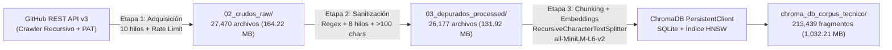

# Documentación Técnica del Corpus Técnico para Tesis

**Proyecto:** Construcción, depuración e indexación vectorial de un corpus técnico multitecnología para recuperación semántica (RAG)  
**Ubicación del paquete organizado:** `corpus_tecnico_tesis/`

---

## 1. Propósito y Arquitectura General del Sistema

El objetivo de este sistema es construir un corpus documental de alta precisión técnica y transformarlo en una **base de datos vectorial persistente** lista para alimentar arquitecturas de Generación Aumentada por Recuperación (*Retrieval-Augmented Generation*, RAG) o asistentes técnicos especializados.

### 1.1 Decisiones de arquitectura: Pipeline desacoplado por etapas

En lugar de implementar un script monolítico que descargue, limpie y vectorice al vuelo, el sistema se diseñó como un **pipeline desacoplado de tres etapas con persistencia intermedia en disco**:



#### ¿Por qué esta arquitectura y qué ventajas ofrece?
1. **Separación de responsabilidades (*Separation of Concerns*):** Cada etapa tiene una entrada y salida bien definidas. Si se requiere ajustar una expresión regular de limpieza o cambiar el tamaño de los fragmentos (*chunks*), no es necesario volver a descargar los 27,470 archivos desde internet.
2. **Tolerancia a fallos y reanudabilidad:** Las descargas masivas sobre APIs externas son propensas a interrupciones de red o límites de cuota. Al persistir la capa cruda (`02_crudos_raw/`) y verificar la existencia previa de cada archivo, el proceso es **idempotente**.
3. **Auditabilidad científica (clave para tesis):** Conservar tanto los datos crudos como los depurados permite medir con exactitud la tasa de retención por repositorio, auditar qué contenido fue descartado y reproducir experimentos con distintos modelos de embeddings o parámetros de fragmentación.
4. **Optimización de recursos locales:** El diseño separa las cargas *I/O-bound* de red (Etapa 1), *I/O-bound* y texto local (Etapa 2) y cómputo vectorial en CPU (Etapa 3), adaptando el grado de concurrencia a cada cuello de botella.

### 1.2 Resumen cuantitativo del pipeline

| Etapa | Directorio en `corpus_tecnico_tesis/` | Artefactos / Registros | Tamaño en disco |
| :--- | :--- | :---: | :---: |
| **Etapa 0** (Prueba de concepto) | `02_datos_corpus/01_prueba_fastapi/` | 5 archivos | 0.06 MB |
| **Etapa 1** (Datos crudos / Raw) | `02_datos_corpus/02_crudos_raw/` | 27,470 archivos (29 repositorios) | 164.22 MB |
| **Etapa 2** (Datos depurados / Processed) | `02_datos_corpus/03_depurados_processed/` | 26,177 archivos | 131.92 MB |
| **Etapa 3** (Base vectorial final) | `03_base_datos_vectorial_final/chroma_db_corpus_tecnico/` | 213,439 fragmentos (6 archivos DB) | 1,032.21 MB |

---

## 2. Selección de Fuentes y Taxonomía del Corpus

### 2.1 Criterios de selección de repositorios
La calidad de un sistema RAG depende directamente de la autoridad y limpieza de su base documental. Se establecieron los siguientes criterios:
- **Fuentes primarias de referencia:** Se priorizaron repositorios oficiales de proyectos ampliamente adoptados en la industria y la academia, evitando blogs informales o foros (donde abundan opiniones no verificadas y ruido conversacional).
- **Cobertura transversal del ciclo de ingeniería de software e IA:** El corpus no se limita a un único framework; cubre desde aprendizaje profundo y MLOps hasta infraestructura en la nube, lenguajes de sistemas, bases de datos y pragmática de ingeniería.
- **Formato textual estructurado:** Se restringió la captura a archivos `.md` (Markdown), `.rst` (reStructuredText) y `.txt`, que concentran la documentación técnica escrita en prosa.
- **Filtrado estructural en origen:** Se excluyeron directorios que históricamente contienen código de pruebas, automatización o dependencias de terceros sin valor como prosa documental: `.github`, `tests`, `examples`, `node_modules`, `vendor` y `ci`.

### 2.2 Inventario completo y tasa de retención por dominio (29 repositorios)

| Dominio | Repositorio | Crudos (`Raw`) | Depurados (`Processed`) | Retención | Objetivo lingüístico / técnico |
| :--- | :--- | :---: | :---: | :---: | :--- |
| **IA y Machine Learning** | `pytorch/pytorch` | 719 | 659 | 91.7% | Tensores, autograd, entrenamiento distribuido. |
| | `tensorflow/tensorflow` | 1,280 | 1,240 | 96.9% | Grafos computacionales, Keras, despliegue. |
| | `huggingface/transformers` | 1,252 | 1,244 | 99.4% | Modelos de lenguaje, tokenización, fine-tuning. |
| | `keras-team/keras` | 18 | 17 | 94.4% | APIs de alto nivel para redes neuronales. |
| | `scikit-learn/scikit-learn` | 223 | 217 | 97.3% | Aprendizaje estadístico clásico y métricas. |
| | `langchain-ai/langchain` | 36 | 33 | 91.7% | Orquestación de LLMs, cadenas y RAG. |
| **Cloud, DevOps e Infraestructura** | `aws/aws-cli` | 18 | 16 | 88.9% | Servicios cloud AWS y línea de comandos. |
| | `kubernetes/kubernetes` | 291 | 229 | 78.7% | Orquestación de contenedores y clústeres. |
| | `docker/docker-ce` | 348 | 300 | 86.2% | Contenerización, imágenes y redes. |
| | `hashicorp/terraform` | 49 | 40 | 81.6% | Infraestructura como código (IaC). |
| | `ansible/ansible` | 194 | 123 | 63.4% | Automatización y gestión de configuración. |
| | `microsoft/azure-cli` | 71 | 66 | 93.0% | Ecosistema cloud Azure y administración. |
| **Backend y Lenguajes** | `tiangolo/fastapi` | 1,461 | 1,434 | 98.2% | APIs REST modernas, tipado y asincronía. |
| | `django/django` | 668 | 664 | 99.4% | Frameworks web MVC/MVT y ORM. |
| | `pallets/flask` | 80 | 76 | 95.0% | Microservicios web en Python. |
| | `python/cpython` | 903 | 884 | 97.9% | Especificación interna del lenguaje Python. |
| | `golang/go` | 1,453 | 1,385 | 95.3% | Concurrencia, goroutines y compilación. |
| | `rust-lang/rust` | 1,477 | 1,383 | 93.6% | Seguridad de memoria y programación de sistemas. |
| **Bases de Datos y Big Data** | `apache/spark` | 1,585 | 1,480 | 93.4% | Procesamiento distribuido a gran escala. |
| | `elastic/elasticsearch` | 3,235 | 2,985 | 92.3% | Motores de búsqueda e indexación invertida. |
| | `mongodb/mongo` | 1,004 | 957 | 95.3% | Bases de datos documentales NoSQL. |
| | `postgres/postgres` | 46 | 44 | 95.7% | SQL relacional avanzado y transacciones. |
| | `redis/redis` | 29 | 27 | 93.1% | Almacenamiento en memoria y caché. |
| **Ingeniería, Guías y Carrera** | `kamranahmedse/developer-roadmap` | 10,485 | 10,133 | 96.6% | Rutas de aprendizaje y mapas tecnológicos. |
| | `firstcontributions/first-contributions` | 398 | 397 | 99.7% | Flujos de contribución Open Source con Git. |
| | `yangshun/tech-interview-handbook` | 74 | 71 | 95.9% | Algoritmos, entrevistas y pragmática técnica. |
| | `jwasham/coding-interview-university` | 34 | 34 | 100.0% | Fundamentos de ciencias de la computación. |
| | `donnemartin/system-design-primer` | 23 | 23 | 100.0% | Diseño de sistemas distribuidos y escalabilidad. |
| | `google/styleguide` | 16 | 16 | 100.0% | Estándares de estilo y legibilidad de código. |
| **Total Global** | **29 repositorios** | **27,470** | **26,177** | **95.3%** | |

---

## 3. Etapa 1: Adquisición de Datos y Crawler sobre GitHub API

### 3.1 De prueba directa a Crawler recursivo
1. **Fase exploratoria (`01_descarga_inicial_prueba_fastapi.ipynb`):** Se validó la descarga puntual mediante URLs directas a `raw.githubusercontent.com` y se definió el patrón de autenticación por cabeceras HTTP. Este enfoque no escala cuando se desconoce de antemano la estructura interna de cientos de subdirectorios en 29 repositorios.
2. **Crawler de producción (`02_descarga_masiva_repositorios_github.ipynb`):** Se construyó un **crawler web especializado sobre la API REST v3 de GitHub** (`https://api.github.com/repos/{repo}/contents/{path}`). A diferencia de un *scraper* HTML convencional, este crawler:
   - Consulta respuestas JSON estructuradas de la API oficial de GitHub.
   - Recorre recursivamente el árbol de directorios (`item['type'] == 'dir'`) aplicando poda temprana (*pruning*) sobre carpetas irrelevantes (`.github`, `tests`, `examples`, `node_modules`, `vendor`, `ci`).
   - Descarga únicamente los nodos hoja cuya extensión coincide con `.md`, `.rst` o `.txt`, replicando la jerarquía de rutas original dentro de `data/raw/<nombre_repo>/`.

#### ¿Por qué usar un Crawler vía API en lugar de `git clone`?
- **Eficiencia de red y almacenamiento:** Clonar 29 repositorios completos (como `pytorch`, `tensorflow`, `rust`, `cpython`, `kubernetes`) implicaría descargar gigabytes de código fuente C++/Python/Rust, binarios de prueba e historial completo de commits. El crawler descarga **únicamente los 164.22 MB** de documentación textual necesaria.
- **Selectividad en tiempo real:** Permite filtrar extensiones y directorios antes de transferir el contenido del archivo.

### 3.2 Uso del Personal Access Token (`GITHUB_TOKEN`) y seguridad
Para ejecutar una descarga masiva de decenas de miles de archivos es indispensable utilizar un **token especial de autenticación (Personal Access Token - PAT)** enviado en la cabecera `Authorization: token <GITHUB_TOKEN>`:

- **¿Por qué se requiere el token?** La API de GitHub impone límites estrictos (*Rate Limiting*) a las peticiones anónimas (sin token, pocas decenas de consultas por hora por IP), lo que bloquearía el crawler antes de terminar siquiera el primer repositorio grande. El uso de un PAT autenticado multiplica drásticamente la cuota disponible por hora (nivel de desarrollador autorizado) y habilita la inspección precisa de los encabezados de cuota.
- **Gestión segura de credenciales:** En lugar de incrustar el token en el código fuente, se almacena en el archivo `.env` (excluido del control de versiones mediante `.gitignore`) y se inyecta en tiempo de ejecución con `python-dotenv` (`load_dotenv()`).

### 3.3 Concurrencia, control de *Rate Limiting* e idempotencia
La versión final del crawler implementa una arquitectura híbrida para maximizar velocidad sin provocar bloqueos de IP:
- **Descubrimiento síncrono, descarga paralela:** La función recursiva `get_all_files()` recorre los directorios de forma síncrona para no saturar los endpoints de metadatos de la API; una vez indexada la lista de archivos de un repositorio, lanza un `ThreadPoolExecutor(max_workers=10)` para descargar los contenidos en paralelo (operación puramente *I/O-bound*). El límite de 10 hilos (con recomendación explícita de no exceder 15) evita ser clasificado como ataque de denegación de servicio o abuso por los balanceadores de GitHub.
- **Monitoreo inteligente de cuota (`check_rate_limit`):** En cada respuesta de la API se leen los encabezados `X-RateLimit-Remaining` y `X-RateLimit-Reset`. Si el remanente cae por debajo de `5` peticiones o se recibe un código HTTP `403`, el crawler calcula exactamente los segundos faltantes hasta el reinicio de la ventana (`reset_time - now + 2`) y suspende la ejecución automáticamente antes de reanudar.
- **Idempotencia y recuperación (`REPO_REANUDAR`):** Cada hilo verifica `os.path.exists(local_path)` antes de hacer la petición HTTP; si el archivo ya existe localmente, se omite. Esto permite reanudar descargas interrumpidas sin pérdida de progreso.

---

## 4. Etapa 2: Depuración, Limpieza y Sanitización de Texto

Implementada en `03_depuracion_y_limpieza_texto.ipynb`, esta etapa transforma archivos crudos de documentación en **prosa técnica pura**.

### 4.1 Justificación técnica de cada filtro
Los documentos Markdown y reStructuredText contienen abundante sintaxis de presentación y fragmentos de código que degradan la calidad de los embeddings semánticos:

1. **Eliminación de bloques de código (`CODE_BLOCK_RE = r"```.*?```"` con `re.DOTALL`):**  
   *Por qué:* Los modelos de embeddings orientados a lenguaje natural (como `all-MiniLM-L6-v2`) pierden precisión semántica cuando un fragmento está dominado por llaves, importaciones, trazas o sintaxis de programación en lugar de explicaciones conceptuales. Eliminar los bloques de código deja únicamente la explicación técnica y arquitectónica.
2. **Eliminación de imágenes (`IMAGE_RE = r"!\[.*?\]\(.*?\)"`):**  
   *Por qué:* Las referencias a diagramas o insignias (*badges* de CI/CD) como `` no aportan información textual útil y contaminan los fragmentos con URLs.
3. **Conversión de enlaces Markdown a texto plano (`LINK_RE = r"\[([^\]]+)\]\([^\)]+\)"` → `\1`):**  
   *Por qué:* Una URL larga rompe la fluidez sintáctica de la oración, pero el texto ancla del enlace suele ser un concepto clave (ej. `[Dependency Injection](https://...)` → `Dependency Injection`). Conservar `\1` preserva el significado completo sin el ruido de la dirección web.
4. **Remoción de etiquetas HTML residuales (`HTML_RE = r"<[^>]*>"`):**  
   *Por qué:* Muchos documentos técnicos mezclan tablas, `<div>`, `<br>` o etiquetas `` de HTML dentro de archivos `.md`.
5. **Normalización de espacios (`\n\s*\n` → `\n\n`) y umbral mínimo (`> 100` caracteres):**  
   *Por qué:* Tras remover código e imágenes, algunos archivos quedan reducidos a títulos vacíos o avisos mínimos. Exigir más de 100 caracteres útiles filtra automáticamente documentos sin densidad informativa (eliminando ~1,293 archivos vacíos o puramente sintácticos, pasando de 27,470 a 26,177 archivos).

### 4.2 Paralelización y desempeño
- **Estrategia:** `ThreadPoolExecutor(max_workers=8)`, dimensionado para aprovechar los **8 hilos lógicos** del procesador (Intel Core i5 de 10.ª generación) y paralelizar las 27,470 operaciones de lectura/escritura en disco.
- **Resultado observado:** Limpieza completa ejecutada en **137.46 segundos**, manteniendo intacta la estructura relativa de carpetas en `data/processed/`.

---

## 5. Etapa 3: Fragmentación, Vectorización e Indexación en ChromaDB

Implementada en `04_vectorizacion_e_ingesta_chromadb.ipynb`, esta etapa convierte el corpus limpio en un índice vectorial consultable por similitud semántica.

### 5.1 Estrategia de fragmentación (*Chunking*)
- **Implementación:** `RecursiveCharacterTextSplitter` de `langchain_text_splitters` con `chunk_size=600` y `chunk_overlap=60` (`length_function=len`).
- **¿Por qué `RecursiveCharacterTextSplitter` y estos valores?**
  - A diferencia de un corte fijo cada *N* caracteres, este fragmentador intenta dividir jerárquicamente por saltos de párrafo (`\n\n`), saltos de línea (`\n`) y espacios antes de recurrir al corte por carácter, preservando unidades lógicas de pensamiento.
  - **600 caracteres (~100 palabras):** Es un tamaño óptimo para recuperación técnica precisa: suficientemente pequeño para que el vector represente un concepto específico (evitando diluir la similitud coseno en documentos largos) y suficientemente amplio para contener una explicación completa.
  - **60 caracteres de solapamiento (10%):** Garantiza continuidad contextual entre fragmentos adyacentes, evitando que una definición o restricción importante quede partida entre dos chunks sin contexto.

### 5.2 Modelo de Embeddings (`all-MiniLM-L6-v2`)
- **Selección:** `sentence-transformers/all-MiniLM-L6-v2` integrado mediante `SentenceTransformerEmbeddingFunction`.
- **¿Por qué este modelo?** Representa el estándar de equilibrio entre **velocidad de inferencia en CPU y precisión semántica** para texto técnico mayoritariamente en inglés. Permite indexar más de 200,000 fragmentos en hardware local sin requerir GPU dedicada, manteniendo baja latencia en tiempo de consulta.

### 5.3 Arquitectura de almacenamiento en ChromaDB
- **Modo de operación:** `chromadb.PersistentClient(path="technical_corpus_db")`, colección `tech_tutor_corpus`.
- **Ventajas de ChromaDB local:**
  - No requiere levantar servicios externos ni contenedores en la fase de prototipado y tesis.
  - Combina **SQLite (`chroma.sqlite3`)** para gestión transaccional de metadatos, colecciones e IDs con un **índice vectorial HNSW** (*Hierarchical Navigable Small World*, almacenado en `e5492149-4d9a-4ead-872a-2ce357eec452/`), lo que permite búsquedas aproximadas de vecinos más cercanos en milisegundos.
- **Esquema de cada registro indexado:**
  - `documents`: Texto limpio del fragmento (`<= 600` caracteres).
  - `metadatas`: `{"source": "<ruta_relativa_desde_processed>"}` — permite al sistema RAG citar exactamente el repositorio y archivo de origen en cada respuesta.
  - `ids`: `f"{file_path.stem}_{idx}"`.
- **Métricas finales:** **213,439 fragmentos** indexados, ocupando **1,032.21 MB** en disco.

### 5.4 Limitaciones detectadas y recomendaciones para futuras iteraciones
1. **Límite de tamaño de lote (*Batch Size*) en `svnmap.txt`:**  
   Durante la ingesta paralela (`MAX_WORKERS = 8`), el archivo `svnmap.txt` generó `8,105` fragmentos en una sola llamada a `collection.add(...)`, superando el límite interno de ChromaDB (`5,461` elementos por lote) y lanzando `ValueError`.  
   *Mitigación recomendada:* En futuras re-ingestas, dividir la lista `chunks` en sub-lotes de máximo `5,000` elementos antes de llamar a `collection.add(...)`.
2. **Unicidad de `ids` basada en `file_path.stem`:**  
   Actualmente el ID usa `f"{file_path.stem}_{idx}"`. Si dos repositorios distintos contienen archivos con el mismo nombre base (por ejemplo, `README.md` o `index.md`), pueden producirse colisiones de ID en ChromaDB.  
   *Mitigación recomendada:* Construir el ID usando la ruta relativa completa normalizada (ej. `str(relative_path).replace("/", "__") + f"_{idx}"`) o un hash corto de la ruta relativa.

---

## 6. Guía de Reproducibilidad y Consulta del Corpus

### 6.1 Estructura final del directorio organizado
```text
corpus_tecnico_tesis/
├── DOCUMENTACION_TECNICA.md                  # Este documento técnico
├── README.md                                 # Guía rápida de estructura
├── .env                                      # Token de GitHub (GITHUB_TOKEN)
├── .gitignore                                # Exclusiones de datos pesados y credenciales
├── 01_notebooks_pipeline/
│   ├── 01_descarga_inicial_prueba_fastapi.ipynb
│   ├── 02_descarga_masiva_repositorios_github.ipynb
│   ├── 03_depuracion_y_limpieza_texto.ipynb
│   └── 04_vectorizacion_e_ingesta_chromadb.ipynb
├── 02_datos_corpus/
│   ├── 01_prueba_fastapi/                    # 5 archivos de prueba inicial
│   ├── 02_crudos_raw/                        # 27,470 archivos crudos (29 repositorios)
│   └── 03_depurados_processed/               # 26,177 archivos depurados
└── 03_base_datos_vectorial_final/
    └── chroma_db_corpus_tecnico/             # Base vectorial ChromaDB (213,439 fragmentos)
```

### 6.2 Requisitos de entorno
```bash
pip install python-dotenv requests chromadb langchain langchain-community langchain-text-splitters sentence-transformers
```

### 6.3 Ejemplo de consulta semántica sobre la base vectorial final
```python
import chromadb
from chromadb.utils import embedding_functions

client = chromadb.PersistentClient(
    path="03_base_datos_vectorial_final/chroma_db_corpus_tecnico"
)
emb_fn = embedding_functions.SentenceTransformerEmbeddingFunction(
    model_name="all-MiniLM-L6-v2"
)
collection = client.get_collection(
    name="tech_tutor_corpus",
    embedding_function=emb_fn
)

print("Total de fragmentos indexados:", collection.count())  # 213439

resultados = collection.query(
    query_texts=["How does Kubernetes handle pod scheduling and resource limits?"],
    n_results=5
)

for doc, meta, dist in zip(
    resultados["documents"][0],
    resultados["metadatas"][0],
    resultados["distances"][0]
):
    print(f"[{meta['source']}] (dist={dist:.4f})\n{doc}\n{'-'*60}")
```
