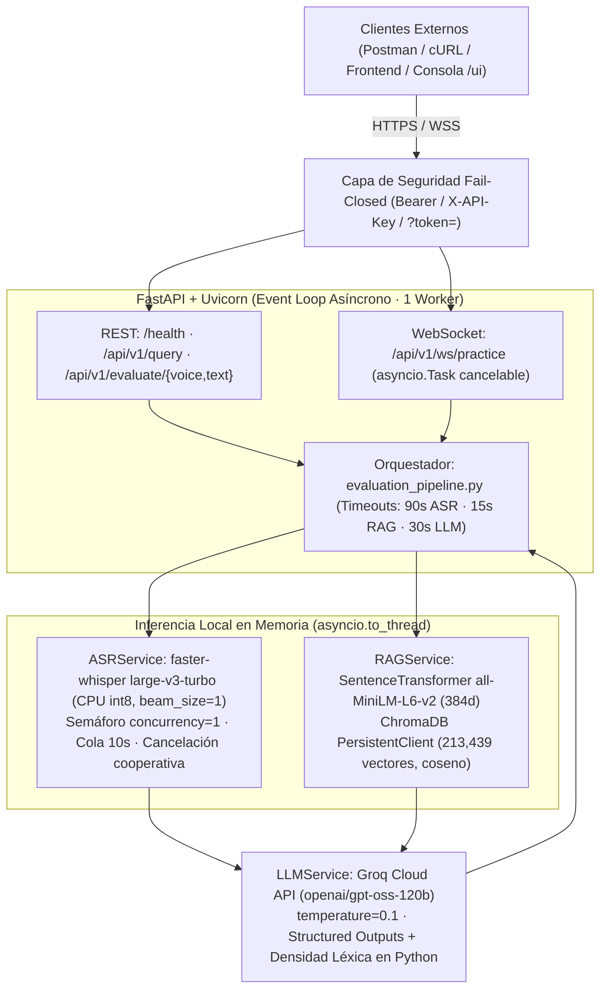

# ESPECIFICACIÓN TÉCNICA FORMAL: MOTOR MAAS DE EVALUACIÓN DE INGLÉS TÉCNICO (`tech-tutor-engine` v1.0.0)

**Proyecto de Tesis:** Asistente de Inteligencia Artificial Especializado en Inglés Técnico para Ingenieros del Área de Tecnología  
**Institución:** Universidad Autónoma de Tlaxcala — Unidad Académica Multidisciplinaria Campus Calpulalpan  
**Programa Académico:** Licenciatura en Ingeniería en Computación  
**Autor:** Jesus Leonardo Beltrán Avila  
**Versión del Sistema:** `1.0.0` (Producción / Defensa de Grado)  
**Fecha de Actualización Técnica:** Noviembre 2026  
**Periodo de Defensa de Grado:** Diciembre 2026 – Enero 2027  

---

## 1. Alcance Técnico y Paradigma Arquitectónico

### 1.1. Definición como Motor Model-as-a-Service (MaaS)

`tech-tutor-engine` se diseña e implementa como un **Motor de Inferencia y Evaluación Técnica Asíncrono (Model-as-a-Service / MaaS)** desacoplado de aplicaciones frontend monolíticas (el desarrollo de una plataforma cliente completa en React/Next.js y agentes conversacionales visuales queda formalmente clasificado como Trabajo Futuro).

El motor expone capacidades de reconocimiento automático de voz (ASR), recuperación semántica aumentada (RAG) y evaluación automatizada bajo rúbricas del Marco Común Europeo de Referencia para las Lenguas (**MCER / CEFR: B1–C2**) mediante interfaces abiertas y estandarizadas:

- **API RESTful Asíncrona (`FastAPI` + `Uvicorn`):** Peticiones transaccionales para diagnóstico de salud (`/health`), introspección vectorial (`/api/v1/query`), evaluación de texto (`/api/v1/evaluate/text`) y evaluación multimodal de audio (`/api/v1/evaluate/voice`).
- **Canal Bidireccional Full-Duplex (`WS /api/v1/ws/practice`):** Ingesta continua de fragmentos binarios de audio (`webm` o `pcm16` mono), transmisión de eventos de progreso por etapa y cancelación reactiva en tiempo real.
- **Contratos Estrictos de Datos (`Pydantic v2`):** Validación tipada de entrada/salida, resolución centralizada de escenarios y serialización determinista en JSON.
- **Portales Integrados sin Dependencias Externas:** Documentación de consumo estilo Oracle (`/docs`), referencia OpenAPI formal (`/redoc`) y consola web interactiva nativa con temas Claro/Oscuro (`/ui`) que consume exclusivamente los endpoints autenticados del propio motor.

### 1.2. Diagrama de Arquitectura del Sistema

---

## 2. Subsistema de Reconocimiento Automático de Voz (ASR)

Implementado en `app/services/asr_service.py` bajo un patrón Singleton precargado durante el `lifespan` de FastAPI (`app/main.py`) con importación perezosa de `faster_whisper` para acelerar el arranque de pruebas unitarias.

### 2.1. Configuración del Modelo y Decodificación en Memoria
- **Motor:** `faster-whisper` (`CTranslate2`) con pesos `large-v3-turbo`, dispositivo `cpu`, cuantización `int8`, `cpu_threads=4`, `num_workers=1`.
- **Decodificación Greedy (`ASR_BEAM_SIZE = 1`):** Optimizada para la arquitectura destilada `large-v3-turbo`, reduciendo la latencia de inferencia en CPU entre un 60 % y 75 % respecto a `beam_size=5` sin comprometer el umbral de precisión académica (WER < 12 %).
- **Cero I/O en Disco:** Los archivos subidos vía REST (`.webm`, `.mp3`, `.wav`, `.ogg`, `.m4a`) se decodifican en memoria mediante `io.BytesIO`. Para compatibilidad con `PyAV 19+`, el servicio aplica `_patch_pyav_metadata_errors()` antes de la decodificación para absorber la eliminación del argumento obsoleto `metadata_errors`.
- **Ruta Directa Cero-Copia WAV para `pcm16`:** En WebSockets con `format="pcm16"`, `pcm16_to_float32()` transforma el buffer little-endian de 16 bits directamente en un arreglo 1D `numpy.float32` normalizado en `[-1.0, 1.0]` a 16 kHz (con re-muestreo lineal si `sample_rate` ∈ `[8000, 48000]` difiere de `16000`), eliminando la creación de contenedores WAV intermedios en `BytesIO`.
- **Sesgo Léxico Técnico (`ASR_INITIAL_PROMPT`) y VAD:** Se activa `vad_filter=True` (`min_silence_duration_ms=500`) y un prompt inicial con terminología de ingeniería (*PyTorch, Kubernetes, Docker, FastAPI, horizontal sharding, microservices, latency, system design*).

### 2.2. Límites de Audio, Concurrencia y Cancelación Cooperativa
- **Límites Estrictos de Entrada:** `MAX_AUDIO_BYTES = 5 MB` (`5,242,880` bytes, rechazo `HTTP 413`) y `MAX_AUDIO_SECONDS = 60.0 s` (rechazo `HTTP 422` mediante `AudioDurationExceededError`).
- **Validación Temprana Pre-Inferencia:** `WhisperModel.transcribe()` decodifica la cabecera y pobla `info.duration` antes de iterar el generador perezoso `segments`. El servicio valida `info.duration <= MAX_AUDIO_SECONDS` **antes** de recorrer `for segment in segments:`, evitando ejecutar la búsqueda en CTranslate2 sobre audios excedidos. En `pcm16`, la duración se valida en tiempo $O(1)$ antes de adquirir el semáforo.
- **Control de Concurrencia en CPU:** `atranscribe_audio_stream()` serializa las peticiones mediante un `asyncio.Semaphore(ASR_MAX_CONCURRENCY)` (enlazado perezosamente al event loop activo, por defecto `1`). Si la espera en cola supera `ASR_QUEUE_TIMEOUT_SECONDS = 10.0 s`, lanza `ASRQueueTimeoutError` → **`HTTP 429 Too Many Requests`**.
- **Cancelación Cooperativa y Prevención de Condición de Carrera:** Se inyecta un `threading.Event` (`cancel_event`) verificado en cada iteración de `for segment in segments:`. Ante un timeout (`ASR_TIMEOUT_SECONDS = 90.0 s` → `HTTP 504`) o una cancelación de WebSocket (`reset`/desconexión), se activa `cancel_event.set()` y el semáforo se libera únicamente vía `worker_task.add_done_callback(...)` cuando el hilo worker sale efectivamente de CTranslate2 (respaldado además por `self._model_lock`).

### 2.3. Métricas Acústicas y Fonéticas (`ASRMetrics`)
Por cada petición de voz se calculan y reportan: `transcription`, `detected_language`, `speech_duration_seconds` (tiempo efectivo de habla tras VAD), `confidence_score` (promedio de $\exp(\text{avg\_logprob})$), `word_count`, `words_per_minute` (WPM), `avg_logprob`, `no_speech_prob` y, cuando se proporciona `expected_transcript` (modo *shadowing* / benchmark), `wer_score` y `cer_score` mediante `jiwer`.

---

## 3. Subsistema de Recuperación Semántica Aumentada (RAG)

Implementado en `app/services/rag_service.py` y aprovisionado por `app/services/corpus_sync.py`.

- **Base Vectorial:** `ChromaDB` (`PersistentClient` sobre `data/technical_corpus_db/chroma.sqlite3`), colección `tech_tutor_corpus` con **213,439 fragmentos indexados** en espacio de distancia coseno (`hnsw:space: cosine`).
- **Modelo de Embeddings:** `SentenceTransformer` (`all-MiniLM-L6-v2`, 384 dimensiones).
- **Fusión Semántica de Escenario (`build_search_query`):** La consulta se construye como `"{escenario_efectivo}: {texto}"`. Cuando el usuario selecciona `target_scenario="custom"`, el escenario efectivo corresponde al texto validado de `custom_scenario` (evitando diluir el embedding con la palabra genérica `"custom"`).
- **Sanitización Post-Recuperación (`sanitize_chunk_text`):** Elimina etiquetas residuales de maquetado (`@article@`, `@video@`, `@feed@`) y colapsa espacios/saltos de línea redundantes para optimizar el presupuesto de tokens hacia el LLM.
- **Aprovisionamiento Automático:** Si el archivo `chroma.sqlite3` no existe localmente al arrancar, `ensure_corpus_available()` descarga el snapshot del dataset privado configurado en `CORPUS_DATASET_REPO` mediante `huggingface_hub.snapshot_download` (con respaldo de 5 documentos base si la descarga está deshabilitada).

---

## 4. Núcleo de Razonamiento Evaluativo (LLM-as-a-Judge)

Implementado en `app/services/llm_service.py` conectado mediante el cliente asíncrono `AsyncOpenAI` hacia **Groq Cloud** (`https://api.groq.com/openai/v1`).

- **Modelo y Determinismo:** `openai/gpt-oss-120b`, `temperature = 0.1`, `reasoning_effort = "low"`, `LLM_STRUCTURED_OUTPUT = true` (JSON Schema estricto con degradación automática a `json_object` si el proveedor rechaza una combinación de parámetros).
- **Rúbricas MCER / CEFR:** Evalúa al candidato en niveles `A2`, `B1`, `B2`, `C1` y `C2` generando `overall_score` (0–100), `grammar_accuracy_score` (0–100), `technical_precision_score` (0–100), `detected_technical_terms` y hasta 6 elementos de `feedback_details` (`vocabulary_enhancement`, `grammar_correction`, `architectural_alignment`) citando el contexto recuperado del RAG (`rag_source_context`).
- **Cálculo Determinista de Densidad Léxica (`compute_lexical_density`):** Para eliminar alucinaciones aritméticas del LLM, el modelo únicamente extrae la lista literal `detected_technical_terms`, mientras el backend calcula de forma determinista:
  $$\text{lexical\_density\_ratio} = \min\left(\frac{|\text{unique\_terms}|}{\max(|\{w \in \text{tokens} : |w| > 1\}|, 1)},\; 1.0\right)$$
- **Aislamiento de Escenarios Personalizados:** Cuando el usuario provee `custom_scenario`, se valida como cadena imprimible de una sola línea (3–120 caracteres) y se inyecta bajo una plantilla descriptiva no instruccional que impide sobreescribir las rúbricas MCER o el esquema JSON.
- **Política de Fallos Estricta:** Ningún error de red, timeout (`HTTP 504`) o respuesta malformada (`LLMServiceError` → `HTTP 502`) fabrica puntajes simulados, preservando la validez científica de los benchmarks.

---

## 5. Contratos de Interfaz, Escenarios y Seguridad

### 5.1. Autenticación Fail-Closed (`app/core/security.py`)
- Comparación en tiempo constante (`hmac.compare_digest`) contra `API_AUTH_TOKEN` (alias `API_TOKEN`).
- Si `API_AUTH_TOKEN` está vacío en el entorno, **todas** las peticiones autenticadas son rechazadas con `HTTP 401` (o cierre WebSocket `1008 Policy Violation`).
- Acepta `Authorization: Bearer <token>`, cabecera `X-API-Key: <token>`, y parámetro `?token=<token>` en el handshake WebSocket.

### 5.2. Catálogo Canónico de Escenarios (`app/schemas/request_schemas.py`)
`TargetScenario` y `resolve_scenario()` constituyen la **fuente única de verdad (SSOT)** compartida por REST JSON, REST `multipart/form-data`, WebSockets, `/docs` y `/ui`:

1. `system_design_interview` — Entrevista de diseño de sistemas distribuidos
2. `code_review` — Revisión de código y refactorización
3. `incident_postmortem` — Análisis post-mortem de incidentes (RCA)
4. `architecture_presentation` — Presentación de arquitectura y defensa académica
5. `daily_standup` — Reunión diaria ágil y planeación de sprint
6. `technical_debugging` — Depuración técnica en vivo y resolución de fallos
7. `devops_ci_cd` — DevOps, pipelines CI/CD e infraestructura cloud
8. `database_optimization` — Modelado, indexación y optimización de bases de datos
9. `api_design_review` — Revisión de contratos REST/GraphQL/gRPC y seguridad API
10. `custom` — Escenario personalizado de ingeniería (**requiere** `custom_scenario` de 3–120 caracteres imprimibles en una sola línea; se rechaza con `422` si se envía `custom_scenario` junto con un escenario predefinido).

*(Se preservan los alias heredados v0.x como `System Design`, `Code Review`, `Thesis Defense` y `Postmortem` vía `_missing_`.)*

### 5.3. Endpoints Expuestos y Códigos de Estado

| Método | Ruta | Autenticación | Descripción |
|---|---|---|---|
| `GET` | `/` | Pública | Índice de descubrimiento del servicio |
| `GET` | `/docs` | Pública | Portal de documentación de consumo API (estilo Oracle, tema claro neutro) |
| `GET` | `/redoc` | Pública | Especificación OpenAPI 3.x en ReDoc 2.1.5 (tema corporativo) |
| `GET` | `/ui` | Pública (shell) | Consola web interactiva (Claro/Oscuro) con pruebas REST/WS autenticadas |
| `GET` | `/health` · `/api/v1/health` | Token | Sonda no bloqueante de disponibilidad de subsistemas |
| `POST` | `/api/v1/query` | Token | Recuperación vectorial directa (`top_k` ∈ `[1, 20]`) |
| `POST` | `/api/v1/evaluate/text` | Token | Pipeline `RAG (15 s) → Groq LLM (30 s)` |
| `POST` | `/api/v1/evaluate/voice` | Token | Pipeline `ASR (90 s, cola 10 s) → RAG (15 s) → Groq LLM (30 s)` |
| `WS` | `/api/v1/ws/practice` | Token (`?token=`) | Streaming de audio con `asyncio.Task` cancelable en `reset`/desconexión |

---

## 6. Verificación, Pruebas y Benchmarks Académicos

### 6.1. Suite Automatizada (`tests/`)
La suite cuenta con **72 pruebas unitarias y de integración** (`pytest -v`, ejecución < 2 s sin acceso a red ni carga de modelos pesados gracias a inyección de dependencias con dobles de prueba en `tests/conftest.py` e importación perezosa):
- `tests/test_api.py`: Contratos REST, autenticación (`401`), escenarios `9 + custom` en REST y WebSocket, saturación de cola (`429`), timeout por etapa (`504`), validación `pcm16`, consola `/ui`, portal `/docs` y `/redoc`.
- `tests/test_asr.py`: Normalización WER/CER, WPM, corte temprano por duración > 60 s antes de iterar segmentos, `pcm16_to_float32`, cancelación cooperativa, semáforo asíncrono y parche `PyAV 19+`.
- `tests/test_rag.py`: Sanitización regex de etiquetas de maquetado, fusión de escenario y ordenamiento por distancia coseno.
- `tests/test_llm.py`: Densidad léxica determinista, parseo tolerante a fences Markdown y propagación de `LLMServiceError`.
- `tests/test_config.py` y `tests/test_schemas.py`: Valores por defecto, alias de entorno y validación estricta de esquemas Pydantic v2.

### 6.2. Protocolo de Evaluación Empírica para la Tesis (`tests/benchmark_thesis.py`)
El script de benchmarks permite recolectar evidencia reproducible en JSON (`benchmark_results/`) contra las metas cuantitativas de la tesis:
- **Exactitud Fonética (ASR):** $\text{WER} < 12\%$ (`python tests/benchmark_thesis.py wer --audio-dir ...`)
- **Calidad de Recuperación (RAG):** $\text{Recall@3} \ge 85\%$ (`python tests/benchmark_thesis.py rag --queries ...`)
- **Latencia de Extremo a Extremo:** Perfilado de latencia por etapa y total (`python tests/benchmark_thesis.py latency --audio ... --runs 20`) documentando la configuración de hardware evaluada.
