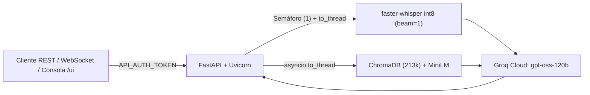

# Tech Tutor Engine

**Asistente de Inteligencia Artificial Especializado en Inglés Técnico para Ingenieros del Área de Tecnología**  
*Proyecto de Titulación · Licenciatura en Ingeniería en Computación · Universidad Autónoma de Tlaxcala (UAM Campus Calpulalpan)*

> El bloque YAML superior mantiene compatibilidad con despliegues en Hugging Face Spaces (`sdk: docker`, `app_port: 7860`).

---

## 1. Visión General

`tech-tutor-engine` es un **Motor de Inferencia y Evaluación Técnica Asíncrono (Model-as-a-Service / MaaS)** construido sobre **FastAPI** que diagnostica y puntúa la competencia en **inglés técnico** (hablado y escrito) de ingenieros de software mediante un pipeline multimodal de tres etapas:

1. **ASR (`app/services/asr_service.py`):** `faster-whisper` (`large-v3-turbo`, CPU `int8`, `beam_size=1`) con decodificación estrictamente en memoria (`io.BytesIO` / arreglo `float32` directo para `pcm16`), parche de compatibilidad para `PyAV 19+`, filtro VAD, `initial_prompt` léxico de ingeniería, límites tempranos de **5 MB / 60 s**, semáforo asíncrono (`ASR_MAX_CONCURRENCY=1`, cola `10 s` → `429`), cancelación cooperativa entre segmentos (`threading.Event`) y métricas acústicas (confianza, WPM y WER/CER opcional con `jiwer`).
2. **RAG (`app/services/rag_service.py`):** `ChromaDB` persistente (`tech_tutor_corpus`, **213,439 vectores**, `all-MiniLM-L6-v2`, similitud coseno) con sanitización regex post-recuperación y fusión de contexto `"{escenario_efectivo}: {texto}"`.
3. **LLM-as-a-Judge (`app/services/llm_service.py`):** `openai/gpt-oss-120b` en **Groq Cloud** (`temperature=0.1`, Structured Outputs con fallback automático a JSON mode) bajo rúbricas **MCER / CEFR (B1–C2)**. La densidad léxica (`lexical_density_ratio`) se calcula de forma **determinista en Python**, nunca por el LLM.



---

## 2. Interfaces Web Incluidas (Cero Dependencias Extra)

| Ruta | Propósito | Acceso |
|---|---|---|
| **`GET /ui`** | **Consola Interactiva de Pruebas** (HTML/CSS/JS nativo con selector **Tema Claro / Oscuro**): captura de micrófono, subida de archivos, streaming WebSocket en vivo con botón `Cancelar / Reset`, evaluación de texto, búsqueda RAG y generador cURL/Postman. | Pública (solicita `API_AUTH_TOKEN` en barra superior) |
| **`GET /docs`** | **Portal de Documentación API** (tema claro corporativo estilo Oracle Docs): guía paso a paso para Postman, cURL y WebSockets, catálogo de escenarios y tabla de códigos HTTP. | Pública |
| **`GET /redoc`** | **Referencia OpenAPI Formal (ReDoc 2.1.5)** con esquemas JSON detallados y tema corporativo neutro. | Pública |
| **`GET /openapi.json`** | Especificación OpenAPI 3.x en JSON. | Pública |

---

## 3. Estructura del Repositorio

```text
tech_tutor_engine/
├── .github/workflows/deploy.yml      # CI (pytest) + despliegue opcional a HF Spaces
├── app/
│   ├── main.py                       # Lifespan (precarga de modelos), CORS, rutas /docs, /redoc, /ui
│   ├── core/
│   │   ├── config.py                 # Pydantic Settings v2 (límites, timeouts, concurrencia, alias)
│   │   ├── logging.py                # Logger estructurado
│   │   ├── openapi_docs.py           # Portal /docs estilo Oracle, tema /redoc, favicon SVG y descripción OpenAPI
│   │   └── security.py               # Autenticación fail-closed (Bearer / X-API-Key / ?token=)
│   ├── api/v1/
│   │   ├── router.py                 # Registro de rutas v1
│   │   └── endpoints/                # health.py, query.py, evaluate.py, websocket.py
│   ├── schemas/                      # request_schemas.py (9+1 escenarios + resolve_scenario), response_schemas.py
│   ├── services/                     # asr_service, rag_service, llm_service, evaluation_pipeline, corpus_sync
│   └── ui/gradio_app.py              # Consola web interactiva nativa en /ui (sin dependencia de Gradio)
├── data/technical_corpus_db/         # Base vectorial local ChromaDB (ignorada por Git)
├── scripts/                          # run_server.py, seed_corpus.py
├── tests/                            # Suite de 72 pruebas (sin red ni pesos) + benchmark_thesis.py
├── Dockerfile                        # Multi-stage CPU, ffmpeg, pre-descarga de modelos
├── requirements.txt / requirements-dev.txt
├── .env.example · .dockerignore · .gitignore · pytest.ini
├── Especificacion_tech_engine.md     # Especificación técnica formal para la tesis (v1.0.0)
└── GUIA_DESPLIEGUE_PRODUCCION.md     # Guía de operación local (Cloudflare Tunnel) y producción 24/7 (Docker/VPS)
```

---

## 4. Ejecución Local Rápida

```powershell
python -m venv .venv
.venv\Scripts\activate                   # Linux/macOS: source .venv/bin/activate
pip install -r requirements-dev.txt
copy .env.example .env                   # Complete GROQ_API_KEY y API_AUTH_TOKEN
python -u -m uvicorn app.main:app --host 127.0.0.1 --port 8000
```

- Consola de pruebas: `http://127.0.0.1:8000/ui`
- Documentación de consumo: `http://127.0.0.1:8000/docs`
- Especificación ReDoc: `http://127.0.0.1:8000/redoc`

### Variables de entorno principales

| Variable (alias) | Valor por defecto | Descripción |
|---|---|---|
| `GROQ_API_KEY` | *(obligatorio)* | Clave de Groq Cloud |
| `API_AUTH_TOKEN` (`API_TOKEN`) | *(obligatorio)* | Token Bearer / `X-API-Key` / `?token=`. **Fail-closed:** si está vacío, toda petición recibe `401` |
| `LLM_MODEL` (`LLM_MODEL_NAME`) | `openai/gpt-oss-120b` | Modelo en Groq Cloud |
| `ASR_MODEL_NAME` (`WHISPER_MODEL_NAME`) | `large-v3-turbo` | Modelo de `faster-whisper` |
| `ASR_BEAM_SIZE` | `1` | Decodificación *greedy* optimizada para baja latencia en CPU |
| `MAX_AUDIO_BYTES` / `MAX_AUDIO_SECONDS` | `5242880` / `60.0` | Límites estrictos de audio (5 MB / 60 segundos) |
| `ASR_MAX_CONCURRENCY` / `ASR_QUEUE_TIMEOUT_SECONDS` | `1` / `10.0` | Serialización de inferencia ASR en CPU y espera máxima antes de `429` |
| `ASR_TIMEOUT_SECONDS` / `RAG_TIMEOUT_SECONDS` / `LLM_TIMEOUT_SECONDS` | `90.0` / `15.0` / `30.0` | Timeouts explícitos por etapa (`504 Gateway Timeout`) |
| `CHROMA_PERSIST_DIRECTORY` (`CHROMA_PERSIST_DIR`) | `./data/technical_corpus_db` | Directorio de la base vectorial ChromaDB |
| `CORPUS_DATASET_REPO` / `HF_TOKEN` | `leonardo-beltran/tech-tutor-corpus` | Dataset privado de HF Hub para descarga automática si falta la base local |

Lista completa en [`.env.example`](.env.example).

---

## 5. API y Catálogo de Escenarios

Todas las rutas de negocio requieren `Authorization: Bearer <API_AUTH_TOKEN>` (o `X-API-Key`), salvo `/`, `/docs`, `/redoc`, `/openapi.json` y `/ui`.

| Método | Ruta | Descripción |
|---|---|---|
| `GET` | `/health` · `/api/v1/health` | Estado del sistema (`chroma_ready`, `asr_ready`, `llm_configured`) |
| `POST` | `/api/v1/query` | Búsqueda semántica directa: `{"query_text": "...", "top_k": 3}` |
| `POST` | `/api/v1/evaluate/text` | Evaluación de texto: `{"candidate_text": "...", "target_scenario": "...", "custom_scenario": null}` |
| `POST` | `/api/v1/evaluate/voice` | `multipart/form-data`: `audio_file`, `target_scenario`, `custom_scenario` (condicional), `expected_transcript` (opcional) |
| `WS` | `/api/v1/ws/practice` | Streaming full-duplex (`?token=`) con eventos `ready → transcribing → retrieving → evaluating → completed` y cancelación vía `{"action": "reset"}` |

**Escenarios soportados (9 predefinidos + `custom`):**
- `system_design_interview` · `code_review` · `incident_postmortem` · `architecture_presentation` · `daily_standup` · `technical_debugging` · `devops_ci_cd` · `database_optimization` · `api_design_review`
- `custom` (requiere `custom_scenario` de **3 a 120 caracteres imprimibles en una sola línea**; no permitido junto a escenarios predefinidos).

**Códigos de respuesta:** `200` éxito · `400` formato/archivo vacío · `401` token inválido (WS `1008`) · `413` audio > 5 MB · `422` audio > 60 s, sin habla o escenario inválido · `429` cola ASR saturada (> 10 s) · `502` fallo de Groq LLM · `503` ASR no inicializado · `504` timeout de etapa.

---

## 6. Pruebas y Benchmarks

```powershell
pytest -v                                   # 72 pruebas unitarias e integración (< 2 s, sin red ni modelos)
python tests/benchmark_thesis.py wer     --audio-dir benchmark_data/audio
python tests/benchmark_thesis.py rag     --queries benchmark_data/queries.json --ks 3 5
python tests/benchmark_thesis.py latency --audio benchmark_data/audio/sample.wav --runs 10
```

Metas cuantitativas de la tesis: **WER < 12 %**, **Recall@3 ≥ 85 %**, **latencia objetivo < 2.5 s** (documentando el perfil de hardware CPU/GPU evaluado).

---

## 7. Despliegue a Producción

Consulte la guía actualizada con las rutas de despliegue local con Cloudflare Tunnel ($0) y producción 24/7 en Docker/VPS en [`GUIA_DESPLIEGUE_PRODUCCION.md`](GUIA_DESPLIEGUE_PRODUCCION.md).
